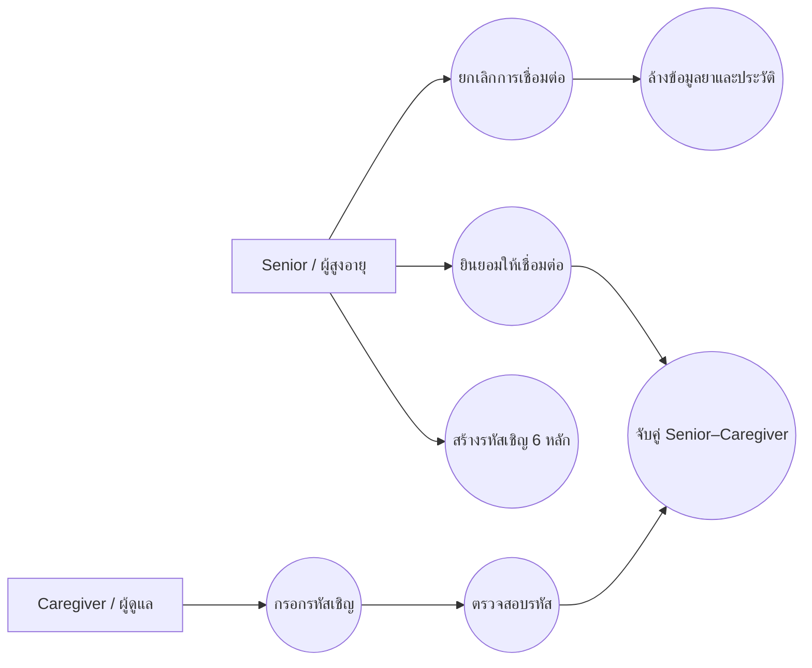
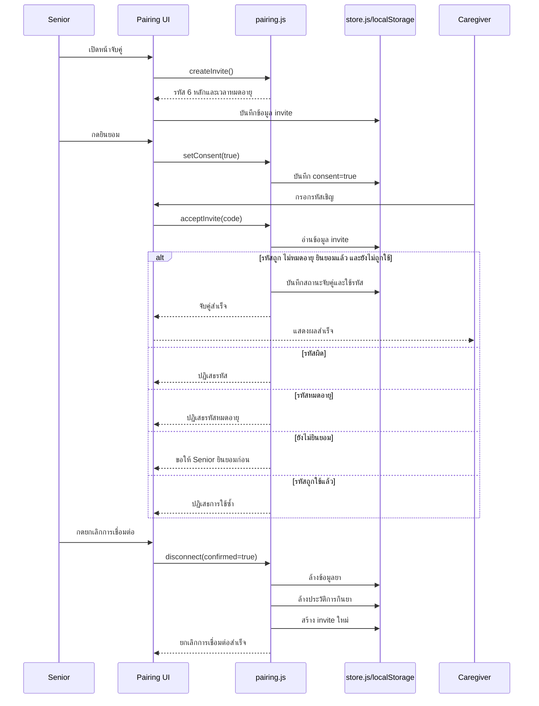
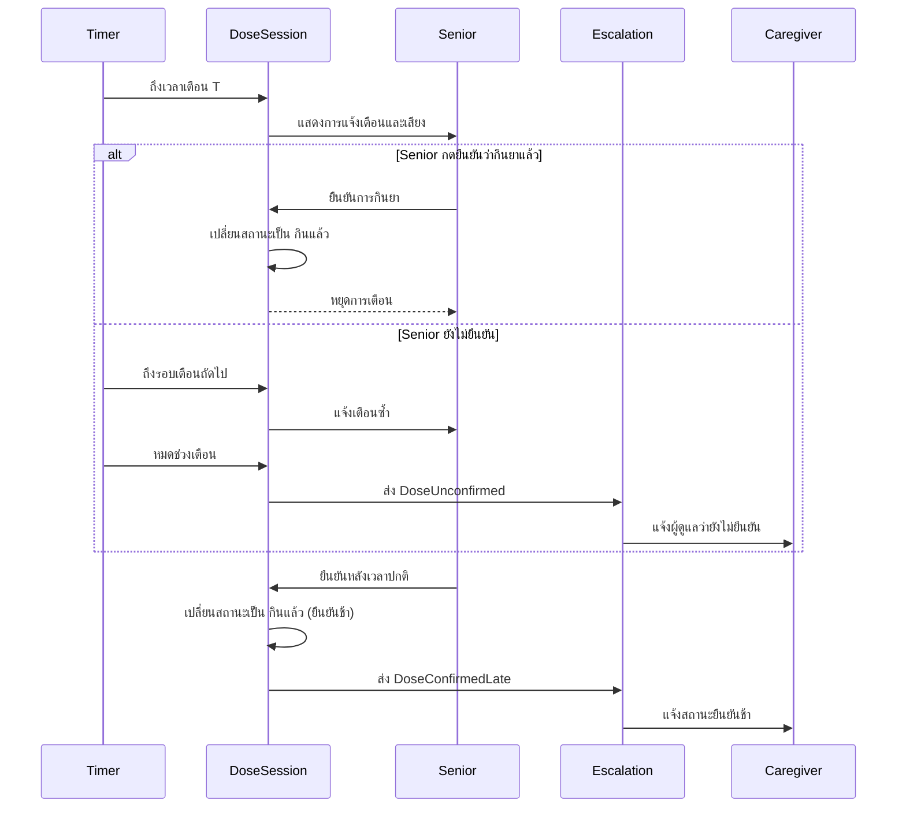
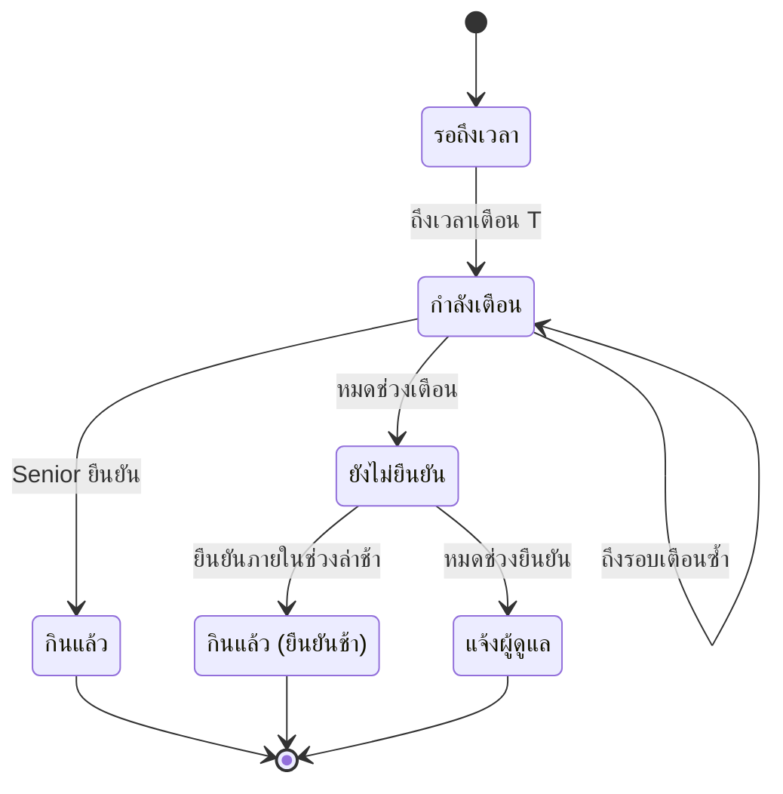
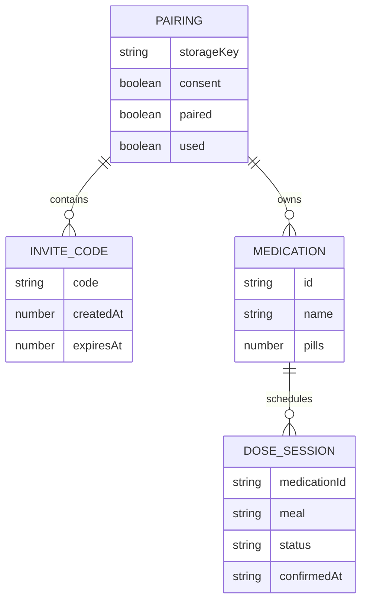

# Architecture & Design — MedMind

> สถานะ: **โครง** · diagram ใช้ Mermaid · ทุก diagram ติดป้าย FR

## 1. Architecture (มาจาก FR) + ADR
## 2. Use Case Diagram
### Use Case Diagram — FR-01 Senior–Caregiver Pairing

กฎของ FR-01:

- รหัสเชิญมี 6 หลัก
- รหัสหมดอายุภายใน 10 นาที
- รหัสเชิญใช้ได้ครั้งเดียว
- ต้องได้รับความยินยอมก่อนจับคู่
- การยกเลิกการเชื่อมต่อต้องล้างข้อมูลยาและประวัติของคู่นั้น

## 3. Sequence Diagram — FR-01 Pairing

## 4. Sequence Diagram — FR-03 → FR-05
### การเตือน ยืนยันการกินยา และแจ้งผู้ดูแล

## 5. State Machine — DoseSession
### State Machine — DoseSession

สถานะของ `DoseSession`:

- `Waiting` — รอถึงเวลา
- `Alerting` — กำลังเตือน
- `Taken` — กินแล้ว
- `Unconfirmed` — ยังไม่ยืนยัน
- `LateTaken` — กินแล้ว (ยืนยันช้า)
- `Escalated` — แจ้งผู้ดูแล

## 6. Data Model / ERD (เฉพาะข้อมูลที่ต้องเก็บ; ห้ามเก็บเลขบัตร ที่อยู่ วันเกิด เบอร์โทร HN)
### Data Model / ERD — localStorage

Key ที่จัดเก็บใน `localStorage`:

| Key | ข้อมูล |
|---|---|
| `medmind-pairing` | รหัสเชิญ consent และสถานะการจับคู่ |
| `medmind-meds` | รายการยา |
| `medmind-taken` | ประวัติการยืนยันการกินยา |
| `medmind-meal-times` | เวลาของมื้อยา |

เมื่อยกเลิกการเชื่อมต่อ:

- `medmind-pairing` ถูกแทนด้วย invite ใหม่
- `medmind-meds` ถูกล้าง
- `medmind-taken` ถูกล้าง
- ไม่ใช้ `localStorage.clear()` เพราะอาจลบข้อมูลของฟีเจอร์อื่น
- ไม่เก็บเลขบัตรประชาชน ที่อยู่ วันเกิด เบอร์โทรศัพท์ หรือ HN

## 7. Module & Event (cohesion / coupling)

> แบบจำลองนี้เป็นเอกสารออกแบบร่วมของทีม และตรวจให้สอดคล้องกับโค้ดจริงก่อน merge

| Module | FR | ข้อมูลที่เป็นเจ้าของ |
|---|---|---|
| `pairing` | FR-01 | Senior, Caregiver, Pairing, InviteCode |
| `medication` (+ adapter `readLabel`) | FR-02 | Medication, MealTimes (เช้า/กลางวัน/เย็น/เข้านอน) |
| `doseSession` | FR-03, FR-04 | DoseSession (มื้อ, เวลาเตือน T, สถานะ: รอถึงเวลา / กำลังเตือน / กินแล้ว / ยังไม่ยืนยัน / กินแล้ว (ยืนยันช้า), รอบที่เตือน, เวลายืนยัน) |
| `escalation` | FR-05 | — (ฟัง event `DoseUnconfirmed`, `DoseConfirmedLate`) |
| `notification` | ใช้ร่วม | NotificationLog |

Events: `MedicationSaved` → `DoseConfirmed` / `DoseUnconfirmed` → `DoseConfirmedLate` (BR-15)

## 8. Coverage: FR → Design (sync-check)

| FR | Design artifact | Implementation / Test |
|---|---|---|
| FR-01 | Use Case Diagram, Sequence Diagram — FR-01, Pairing state/flow, localStorage ERD | `prototype/js/logic/pairing.js`, `prototype/js/features/pairing.js`, `prototype/tests/pairing.test.js` |
| FR-02 | Medication and label flow | `prototype/js/logic/labelParser.js`, `prototype/js/logic/labelForm.js` |
| FR-03 | Sequence Diagram — FR-03 → FR-05, DoseSession state machine | `prototype/js/logic/reminder.js` |
| FR-04 | Sequence Diagram — FR-03 → FR-05, DoseSession state machine | `prototype/js/logic/confirm.js` |
| FR-05 | Sequence Diagram — FR-03 → FR-05, escalation flow | `prototype/js/logic/reminder.js` |